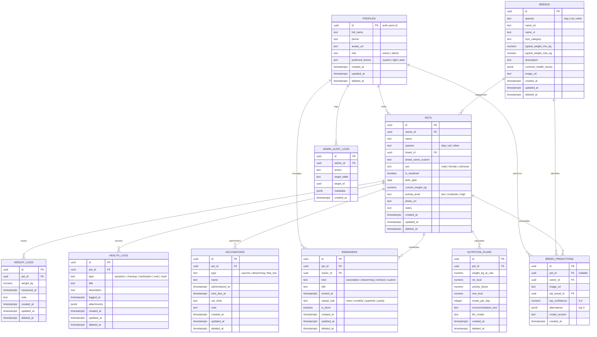

# 🐾 PawCare AI — Database Entity-Relationship (ER) Diagram & Data Dictionary

Tài liệu thiết kế cơ sở dữ liệu Supabase (PostgreSQL 15+) phục vụ PawCare AI.

---

## 1. Sơ đồ Thực thể Mối quan hệ (Mermaid ER Diagram)

---

## 2. Từ điển Dữ liệu (Data Dictionary)

### 2.1. `profiles`
Bảng lưu trữ thông tin mở rộng của người dùng (tự động đồng bộ từ `auth.users`).

| Tên cột | Kiểu | Ràng buộc | Mô tả |
| :--- | :--- | :--- | :--- |
| `id` | UUID | PK, FK -> `auth.users(id)` | Mã người dùng |
| `full_name` | TEXT | NOT NULL | Họ và tên |
| `phone` | TEXT | NULLABLE | Số điện thoại liên hệ |
| `avatar_url` | TEXT | NULLABLE | Link ảnh đại diện (bucket `avatars`) |
| `role` | TEXT | DEFAULT 'owner' | Vai trò: `'owner'` hoặc `'admin'` |
| `preferred_theme` | TEXT | DEFAULT 'system' | Giao diện: `'system'`, `'light'`, `'dark'` |
| `created_at` | TIMESTAMPTZ | DEFAULT `now()` | Thời điểm tạo |
| `updated_at` | TIMESTAMPTZ | DEFAULT `now()` | Thời điểm cập nhật cuối |
| `deleted_at` | TIMESTAMPTZ | NULLABLE | Thời điểm xóa mềm (soft delete) |

### 2.2. `breeds`
Bảng danh mục giống thú cưng tham chiếu, hỗ trợ nhận diện AI và tính toán RER/MER.

| Tên cột | Kiểu | Ràng buộc | Mô tả |
| :--- | :--- | :--- | :--- |
| `id` | UUID | PK, DEFAULT `gen_random_uuid()` | Mã giống loài |
| `species` | TEXT | CHECK IN ('dog','cat','other') | Loài |
| `name_en` | TEXT | NOT NULL | Tên tiếng Anh chuẩn quốc tế |
| `name_vi` | TEXT | NOT NULL | Tên tiếng Việt thân thuộc |
| `size_category` | TEXT | toy, small, medium, large, giant | Phân hạng kích cỡ |
| `typical_weight_min_kg` | NUMERIC(5,2) | NULLABLE | Cân nặng chuẩn tối thiểu |
| `typical_weight_max_kg` | NUMERIC(5,2) | NULLABLE | Cân nặng chuẩn tối đa |
| `description` | TEXT | NULLABLE | Đặc điểm nhận dạng & tính cách |
| `common_health_issues` | JSONB | DEFAULT `'[]'` | Các bệnh lý di truyền phổ biến |
| `image_url` | TEXT | NULLABLE | Ảnh đại diện chuẩn |

### 2.3. `pets`
Thông tin chi tiết thú cưng thuộc sở hữu của chủ nuôi.

| Tên cột | Kiểu | Ràng buộc | Mô tả |
| :--- | :--- | :--- | :--- |
| `id` | UUID | PK | Mã định danh thú cưng |
| `owner_id` | UUID | FK -> `profiles(id)` | ID chủ sở hữu |
| `name` | TEXT | NOT NULL | Tên thú cưng |
| `species` | TEXT | dog, cat, other | Loài |
| `breed_id` | UUID | FK -> `breeds(id)` | Giống chuẩn (nếu có) |
| `breed_name_custom` | TEXT | NULLABLE | Tên giống tự nhập (nếu giống lai) |
| `sex` | TEXT | male, female, unknown | Giới tính |
| `is_neutered` | BOOLEAN | DEFAULT `false` | Trạng thái triệt sản (ảnh hưởng RER/MER) |
| `birth_date` | DATE | NULLABLE | Ngày sinh |
| `current_weight_kg` | NUMERIC(5,2) | NULLABLE | Cân nặng hiện tại (kg) |
| `activity_level` | TEXT | low, moderate, high | Mức độ vận động (ảnh hưởng hệ số MER) |
| `photo_url` | TEXT | NULLABLE | Ảnh thú cưng (bucket `pet-photos`) |
| `notes` | TEXT | NULLABLE | Ghi chú đặc biệt |

### 2.4. `weight_logs` & `health_logs`
Nhật ký theo dõi thể trạng thú cưng, phục vụ vẽ biểu đồ tăng trưởng và tiền sử khám bệnh.
- `weight_logs`: Ghi nhận cân nặng theo dòng thời gian (`measured_at`).
- `health_logs`: Phân loại triệu chứng (`symptom`), kiểm tra định kỳ (`checkup`), dùng thuốc (`medication`), ghi chú chung (`note`), khẩu phần ăn (`meal`).

### 2.5. `vaccinations` & `reminders`
Lịch tiêm phòng, tẩy giun, phòng ve rận và các nhắc nhở chăm sóc (Realtime enabled).

### 2.6. `nutrition_plans`
Lưu trữ kết quả tính toán khoa học:
- **RER (Resting Energy Requirement)**: $RER = 70 \times (\text{cân nặng})^{0.75}$
- **MER (Maintenance Energy Requirement)**: $MER = RER \times \text{activity\_factor}$
- Lời giải thích tự nhiên sinh ra bởi LLM/AI.

---

## 3. Chiến lược Đồng bộ (Sync Index Strategy)

Mọi bảng thay đổi dữ liệu đều có composite index:
- `(owner_id, updated_at)`: Tối ưu truy vấn kéo dữ liệu (Pull) của chủ nuôi.
- `(pet_id, updated_at)`: Tối ưu truy vấn dữ liệu con của từng bé cún/mèo.
- Toàn bộ thao tác xóa của người dùng chỉ gán `deleted_at = now()`, cho phép Sync Engine nhận biết bản ghi đã bị xóa trên các thiết bị khác.

